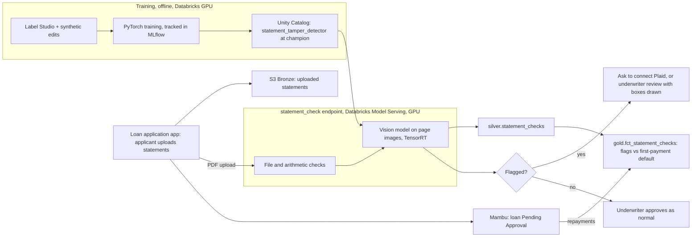

# Edited Bank Statements: Computer Vision with PyTorch

**Attaches to:** `project-stories/fintech/`, at the loan application step, before a loan is approved in Mambu.
- **What already exists:** a small business applies for a loan in our application app. The app creates the loan in Mambu, our lending system, and writes the Mambu ID onto the customer's Salesforce record (`03-processing-spark-databricks.md`).
- **What this adds:** a check that each uploaded bank statement hasn't been edited, using a model of our own, before an underwriter (the person who decides whether to lend, and how much) approves the loan.

## Problem statement

**The business rule:** how much we lend depends on how much money the business really makes. Underwriting looks at the last 3 months of bank statements, and one rule is "maximum loan ≈ average monthly deposits" (confirm).

**How statements reach us:**
- **Preferred route, a bank connection:** the applicant logs into their bank through Plaid (a service that connects apps to bank accounts), and we receive the transactions straight from the bank. Nothing can be edited.
- **Fallback, uploaded PDFs:** many small businesses refuse to connect, or their bank isn't supported. So about 40% of applicants upload PDF (Portable Document Format) statements instead (confirm).

**The fraud:** a fake business, "Joe's Grill", opens a PDF editor and changes its monthly deposits from \$18,400 to \$48,400. It qualifies for ~\$48,000 instead of ~\$18,000, gets paid out, and never makes a single repayment. That's a *first-payment default*, a classic sign of fraud. It lands in Mambu as a defaulted loan and pushes up the default rate in our dashboards.

**Why people miss it:** at normal size the edited PDF looks perfect. The edit shows only in tiny details: one number in a slightly different font, spacing, or sharpness, or a pasted-over area with a faint edge. Fraudsters often also flatten the PDF into a plain picture, so there is no text left to inspect, only pixels.

**Why it matters (confirm):** bank statements are the document lenders say fraudsters edit most. Across our PDF-upload loans, 2.1% were first-payment defaults, against 0.6% for loans with a bank connection.

**What we need:** a check that looks at every uploaded page the way a forensic examiner would, fast enough to answer while the applicant is still in the app.

## Pipeline

**How to read it:**
- **Bottom path (app → endpoint → Flagged?):** the live check, which answers within seconds of the upload.
- **Top right (Silver → Gold, with Mambu repayments):** every result is stored, then compared later with whether the loan was actually repaid.
- **Training box:** how the model is taught. It's retrained as fraud changes.

## Explanation

### The platforms

| Platform / tool | What it is | Its job here |
|---|---|---|
| Plaid | A service that connects apps to customers' bank accounts | The preferred route: no PDF, so nothing to edit |
| Mambu | Our lending system | Holds the loan as *Pending Approval* until the check is cleared; later holds the repayments |
| Amazon S3 (Simple Storage Service) | Cloud file storage | Keeps every uploaded statement untouched in Bronze, the raw layer: `s3://company-raw/loan-applications/statements/date=.../` |
| Databricks | A platform for data and ML (machine learning) work on rented cloud machines | Trains the model, and hosts it |
| Databricks Model Serving | Databricks' service that runs a model behind a web address (an *endpoint*), so an app can send it a file and get an answer back in seconds | Runs the live check, `statement_check`, on a GPU |
| GPU (Graphics Processing Unit) | A chip that does thousands of small calculations at once | Image models need huge amounts of maths, so a GPU answers in milliseconds instead of seconds |
| PyTorch | The most widely used Python library for building and training neural networks | The model is built and trained in it |
| Label Studio | A tool where people draw boxes on images to create training examples | Marking the edited areas on real fraud cases |
| MLflow | A tool that records every training attempt and stores model versions | Our model history |
| Unity Catalog | Databricks' system for permissions and for listing data and models | Where the approved model version is published |
| TensorRT | NVIDIA's tool that makes a trained model run faster on NVIDIA GPUs | Keeping the answer within seconds |
| Snowflake + dbt (data build tool) | Our warehouse, plus the tool that builds its tables from SQL | Compares flags with real repayment outcomes |
| Datadog | Our monitoring tool (`07`) | Watches speed and flag rate |

**Why we built it instead of keeping a vendor:** products such as Ocrolus and Inscribe do this, and we started with one. We built our own for three reasons (confirm):
1. **Cost:** they charge per document, and our volume is high.
2. **Our own fraud:** we can train on fraud patterns from our own defaulted loans.
3. **Sensitive data:** statements hold account numbers and every transaction a business makes, and building in-house keeps them inside our AWS (Amazon Web Services) account.

### Step 1: The applicant uploads statements

- **In Mambu:** the app creates the loan in Mambu with status *Pending Approval*. Mambu won't let it move to *Approved*, and so be paid out, until underwriting signs off.
- **The check is called right away:** the app sends each PDF to the `statement_check` endpoint and saves a copy to Bronze.
- **Volume:** ~2,400 PDF applications a month, each with 3 statements of ~4 pages, so ~29,000 pages a month (confirm).

### Step 2: File and arithmetic checks (simple rules, no AI (Artificial Intelligence))

- **File details:** every PDF records which program created it and which program last saved it. A real statement is made by the bank's own system. "Last saved by a PDF editor" is a red flag.
- **Arithmetic:** where the PDF still contains text, the endpoint reads the balances and checks that opening balance + deposits − withdrawals = closing balance. A crude edit to one deposit breaks the sum.
- **Their limit:** a careful fraudster fixes the sums and flattens the PDF into a picture, which wipes the file details. That's what the vision model is for.

### Step 3: The vision model looks at the pages

- **Computer vision** means teaching a computer to understand images. Each page is turned into an image, and the model looks at the pixels.
- **What it does:** it's an *object-detection* model, meaning it finds things in an image and draws a box around each one. Here it boxes any area that looks edited, with a confidence score from 0 to 1.
- **What it notices:** the same signs a forensic examiner looks for:
  - digits whose edges are smoother or sharper than the rest of the page;
  - spacing between characters that doesn't match;
  - a rectangle where the background is slightly different, left behind by pasting.
- **The model type:** a neural network (layers of simple maths that learn patterns from examples) of the Faster R-CNN (Region-based Convolutional Neural Network) kind. It works in two steps: first it proposes "this area might be interesting", then it looks closely at each area and decides. That suits tiny details like one edited number.
- **The decision:** a statement is *flagged* if any box scores above the cut-off, or if Step 2 found a red flag.

### Step 4: What happens to a flagged application

- **A flag never rejects anyone.** Honest statements can look odd too, for example from a small bank's unusual software. So:
  1. **First,** the app asks the applicant to connect their bank through Plaid instead. Honest applicants usually do. Fraudsters usually leave.
  2. **If they can't,** an underwriter reviews the statement, with the suspicious areas boxed, and decides.
- **Why the answer must come within seconds:** if we ask for the bank connection while the applicant is still on the upload screen, they can do it right away. If we ask the next day by email, many honest applicants never come back.
- **A person decides.** The model only adds friction or routes to an underwriter. This also matters for fair lending law: under the US ECOA (Equal Credit Opportunity Act), a rejected applicant must be told why. Since a person makes every rejection, the reason is always one a person can explain.

### How the model is taught (training)

- **Real fraud examples:** ~600 statements the fraud team has confirmed as edited, for example by calling the bank (confirm). Each has the edited areas boxed in Label Studio.
- **Real genuine examples:** statements from loans that were repaid in full, so we're confident they're real.
- **Synthetic (artificially made) edits:**
  - 600 real cases are too few to learn from, so a script takes genuine statements and edits them the way fraudsters do: it changes digits, pastes in areas, and flattens to an image.
  - Because the script made the edits, it knows exactly where they are, so the labels come free. That's ~30,000 extra examples (confirm).
  - They're used for training only. Testing uses real cases.
- **Transfer learning:** we start from a model already trained on millions of everyday photos, which already knows edges and textures. We replace its last layer and keep training it on our statements, called *fine-tuning*. This needs far fewer examples than starting from nothing.
- **Training runs** on a Databricks GPU machine for a few hours. Each full pass over the training data is called an *epoch*. MLflow records every run.

### How we proved it works (testing)

- **Split by business and by time:**
  - All statements from one applicant stay in the same set. Otherwise the test is too easy, a mistake called *data leakage*.
  - The test set is the most recent months, because fraud changes over time and we want to know how the model does on *new* tricks.
- **Two numbers, and the business trade-off:**
  - **Recall:** out of truly edited statements, how many we flag. A miss can cost a whole loan.
  - **False-positive rate:** out of genuine statements, how many we wrongly flag. Each one adds friction for an honest customer.
  - **Choosing the cut-off:** a flag only asks for a bank connection; it doesn't reject. So we can accept some false positives to catch more fraud.
- **Result (confirm):** on the test set (400 confirmed edited statements, 4,000 genuine ones), the model flagged 92% of edited statements and 2% of genuine ones.
- **Shadow mode:** for 4 weeks the model ran on every upload but changed nothing. We compared its flags with what underwriters and the fraud team found, and only then let it affect applications.

### Making it fast (TensorRT)

- **Inference** means using a trained model to make predictions, as opposed to training it.
- **Latency** is how long one answer takes. Here it's what matters, because the applicant is waiting on the screen.
- **What TensorRT does:** it rebuilds the trained model for the specific NVIDIA GPU, merging steps and using smaller numbers, so the same answers come out faster.
- **Smaller numbers (quantization):** models normally use 32-bit numbers.
  - **FP16 (16-bit numbers):** cut a page from ~120 to ~45 milliseconds (thousandths of a second) with the same test result (confirm). A 12-page upload is checked in about a second, so we use it.
  - **INT8 (8-bit whole numbers):** faster still, but it lost the faintest edits, exactly the careful fraud we most need to catch. So we rejected it.

### Releasing, learning, and watching

- **Model registry:** every trained version is stored in Unity Catalog. The endpoint always runs the version labelled `champion`.
  - **Release:** move the label to a new version after it passes the test set.
  - **Rollback:** move the label back, with no code change.
- **Closing the loop with Mambu:**
  - **The join:** every result lands in `silver.statement_checks`. dbt joins it with each loan's repayments from Mambu into `gold.fct_statement_checks`.
  - **What it answers:** did flagged loans that were approved anyway default more? Did unflagged loans still default early?
  - **New training data:** an unflagged loan that defaults on its first payment is a likely miss. The fraud team reviews it, and confirmed cases become new training examples. Retraining is monthly (confirm), because fraudsters adapt.
- **Monitoring (Datadog):**
  - **Speed:** an alert if the endpoint gets slow, e.g. 95% of answers must come within 2 seconds (confirm).
  - **Flag rate:** an alert if the share of flagged statements jumps or drops, a sign of a new fraud trick or a bank changing its statement design.
- **A known limit:** fraudsters now also generate whole fake statements with AI. These have no edited area to box. File details, Plaid, and the arithmetic check are the defence there, and labelled examples of these fakes are being collected for a future model (confirm).
- **Personal data:** statements contain account numbers and transactions. Only underwriting and fraud staff can view them, and the account numbers are masked everywhere else in the pipeline.

## User story

Joe's Grill applies for a loan and uploads 3 statements. Mambu creates loan `L-9034` as *Pending Approval*.

Within 2 seconds the check comes back:
- **File details:** "last saved by a PDF editor", although the page was flattened to an image, so there wasn't much else to read.
- **Vision model:** a box around "48,400.00" in the deposits total (score 0.94), and two more around single deposits (0.88, 0.81). Their digits are slightly sharper than every other number on the page.

The app asks Joe's Grill to connect its bank through Plaid instead. It never does. An underwriter opens the boxed pages, sees the edits, and declines the application. `L-9034` is never paid out.

The same week, Jane's Bakery is flagged too: its small credit union's statement software produces unusual fonts. Jane connects her bank through Plaid in under a minute, the real deposits confirm the PDFs, and her loan is approved the same day.

After 6 months (confirm), first-payment defaults on PDF-upload loans fell from 2.1% to 0.9%, while ~2% of honest applicants were asked for a bank connection.
