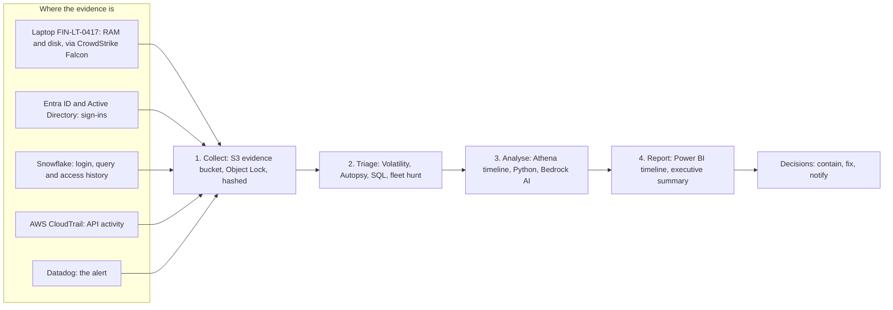

# Stolen Snowflake Login: Problem and Pipeline

**Attaches to:** `project-stories/fintech/`, at two existing points:
- **Snowflake Gold** (`05`): the system the attacker reached. Gold's masking policies and token-only card data decide how much was exposed.
- **Datadog monitoring** (`07`): where the incident is first detected.

**What this adds:** a DFIR (Digital Forensics and Incident Response) pipeline that collects the evidence, finds what happened, and produces a timeline and a report that leadership and regulators can act on.

## Problem statement

**In two sentences:** a password-stealing program on one analyst's laptop stole their saved Snowflake login, and four days later someone used it at 3 a.m. to query customer and payment tables. Within 24 hours we had to prove how they got in, what they saw, whether anything else was affected, and who we must notify, with evidence that would stand up to auditors and regulators.

**What happened (illustrative, confirm):**

| When (UTC) | Event |
|---|---|
| Tue 4 Mar, 14:20 | Sam Rivera, a risk analyst, searches for a free PDF converter and installs `PDFConvert_Setup.exe` from an ad on laptop `FIN-LT-0417`. It's an **infostealer**: malware that copies passwords saved in the browser and sends them to the attacker. |
| Tue 4 Mar, 14:21 | CrowdStrike Falcon, our EDR (Endpoint Detection and Response) agent, raises a medium-severity alert. It sits in the queue. |
| Fri 7 Mar, 03:12 | Someone logs into Snowflake as `SAM_RIVERA` from IP `185.220.x.x`, never seen before. Two gaps let them in (confirm): **(1)** the account's network policy (IP allowlist: office and VPN (Virtual Private Network) only) didn't apply to Sam, because a user-level "allow any IP" exception added during last year's VPN outage was never removed, and a user-level policy overrides the account's; **(2)** they used the stolen password through the Python connector, where MFA (Multi-Factor Authentication) for existing users wasn't yet enforced (Snowflake's deadline was October 2026). |
| Fri 7 Mar, 03:14–03:41 | 14 queries on `gold.dim_customer` and `gold.fct_payments`; results downloaded (~4 GB). |
| Fri 7 Mar, 03:30 | Datadog pages on-call: a login from a new country for a human user, plus a credit spike on `ADHOC_WH`, the ad-hoc query warehouse. |

**Why this is realistic:** it's the pattern of the 2024 Snowflake customer breaches. Mandiant traced every case it investigated to passwords stolen by infostealers, on accounts with no MFA and no IP allowlist. There was no flaw in Snowflake itself.

**What we must answer:**
1. **How did they get in?** Which machine, which malware, and which credential.
2. **What did they see or take?** Which tables and rows, and what was masked.
3. **Is anything else affected?** Other laptops, other users, our AWS (Amazon Web Services) account.
4. **Are they still in?** Active sessions, other stolen passwords, anything left behind to get back in.
5. **Who must we tell?** Legal, the card networks under PCI-DSS (Payment Card Industry Data Security Standard), regulators, customers.

**Constraints:**
- **Evidence must hold up:** every file is hashed and logged when collected, and stored where nobody can change it.
- **Don't switch the laptop off:** the malware lives partly in RAM (Random Access Memory), which is lost at power-off. Isolate it from the network instead.
- **Customer data never goes to a public AI tool.**
- **First answer to leadership within 24 hours** (confirm).

## The pipeline

| Phase | In one line | Output |
|---|---|---|
| **1. Collect** | Gather RAM, disk and logs from every system involved into one locked bucket | Hashed evidence in `s3://company-forensics-evidence/case-2026-031/` |
| **2. Triage** | Throw away normal activity and keep what's suspicious | ~40 suspicious events out of ~2 million (confirm) |
| **3. Analyse** | Put every event on one timeline; use AI to explain and group, with a person checking | `case_2026_031.timeline` plus a draft narrative |
| **4. Report** | Show how they got in, what they touched, and what we fixed | A Power BI timeline, a one-page executive summary, a technical report |

**The answers (illustrative, confirm):**
1. **Way in:** the fake installer stole the Snowflake password saved in Chrome; a forgotten user-level allowlist exception let it work from the attacker's IP.
2. **What they took:** 412,000 customer rows (business name, segment, contact email) and February payments. Identity columns were masked (`***MASKED***`), and card data exists only as tokens, so no card numbers were exposed.
3. **Elsewhere:** one other laptop downloaded the same file, but Falcon blocked it. No other Snowflake user logged in from the attacker's IPs. CloudTrail shows no activity from them in AWS.
4. **Still in?** No. `SAM_RIVERA` was disabled at 03:52, its sessions ended and the password rotated. The laptop was wiped after evidence collection.
5. **Notify:** legal decided on customer notice for contact emails. No card-network report, because no card numbers were exposed.
