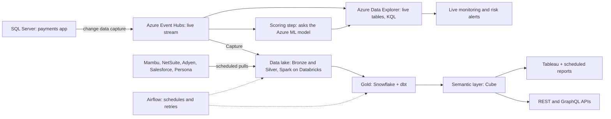

# The Whole Pipeline — Azure Data Explorer, SQL Server, and Real-Time Scoring

Same fintech story as `project-stories/fintech/`, with the JD's (Job Description's) main technologies swapped in: SQL Server, Azure Event Hubs, Azure Data Explorer, KQL, Azure ML, and a semantic layer with APIs. The rest (Bronze/Silver/Gold, Spark, dbt, Airflow, Tableau) is borrowed from the original.

## The story in two sentences

A growing fintech had data spread across many systems, so teams got different numbers, reports were built by hand, and risky payments were only spotted the next day. I built one platform that streams payments live for second-by-second monitoring and fraud scoring, and also feeds a trusted reporting layer that produces reports and APIs automatically.

## The problem

The original problems still apply (`00-problem-statement.md`). Two of them go one step further here:
- **Late data:** data science had a fraud model, but it only ran overnight. A stolen card used for 30 small test payments in 10 minutes was flagged the next morning.
- **Reports by hand:** analysts rebuilt the same Tableau workbooks every month. The product team (showing merchants their sales in the app) and data science (getting training data) both had to ask an analyst for spreadsheets.

## Three kinds of pipeline

| Kind | Plain meaning | In this story |
|---|---|---|
| **Real-time** | Watch events within seconds | SQL Server → Event Hubs → Azure Data Explorer → live alerts and fraud scores |
| **Transactional** | Copy every database change exactly, in order | SQL Server's change log → data lake (Bronze/Silver) |
| **Reporting** | Trusted tables for dashboards and apps | Gold → semantic layer → Tableau, automatic reports, APIs |

## 1. Sources

- **SQL Server** (Microsoft's database for live app data) holds every payment, about 5 million a day (confirm). It's built for fast small writes, so heavy reports would slow the app; that's why we copy the data out.
- **The other five sources** are pulled on a schedule, as in the original story.

## 2. Real-time: SQL Server → Event Hubs → Azure Data Explorer

- **Getting changes out:** SQL Server's built-in CDC (Change Data Capture) records every new or changed payment without slowing the app. Debezium sends each change out as an event.
- **Azure Event Hubs** is Azure's version of Kafka: a conveyor belt for events. Two readers take from it: Azure Data Explorer for live monitoring, and Event Hubs Capture, which saves every event to the data lake.
- **Azure Data Explorer (ADX)** is a very fast database for time-stamped data that keeps arriving. It answers "what happened in the last 10 minutes?" over billions of rows in about a second. It does work that takes several layers elsewhere:
  - **Streaming ingestion:** payments are queryable about 5 seconds after they happen (confirm).
  - **Update policy:** a clean-up rule that runs on every new batch, turning raw change events into a readable payments table.
  - **Caching policy:** the last 30 days are kept on fast disks.
  - **Retention policy:** data older than 2 years is deleted automatically, since the full history is in the lake (confirm).
  - **Materialized view:** a running summary ADX updates itself, e.g. each card's payment count per 10 minutes.
- **KQL (Kusto Query Language)** is how you ask ADX questions. It reads like a recipe: take a table, keep the last 10 minutes, count payments per card, show cards with many payments at many shops. That one query, run every minute, catches card testing in about 2 minutes instead of the next morning (confirm).
- **The same pattern as IoT (Internet of Things):** payment events behave like sensor readings (high-volume, time-stamped, never edited), so this is the same Event Hubs → ADX → live KQL pattern used for device telemetry.

## 3. Machine learning in the pipeline

- **Who does what:** data science builds the fraud model. I put it *into* the pipeline, so it scores every payment live instead of once a night.
- **Azure ML (Azure Machine Learning):** the model is trained, saved as a version, then deployed as an **online endpoint**: a web address that takes a payment's details and returns a risk score from 0 to 1 in milliseconds.
- **Scoring:**
  1. For each payment, a small scoring step adds the card's recent activity from ADX.
  2. It asks the endpoint for a score and writes the score back into ADX.
  3. Anything above 0.9 alerts the risk team within seconds (confirm).
- **Safe updates:** a new model version first gets 10% of payments; if it looks right, it gets 100%. We also watch for **drift**, the model getting worse as fraud patterns change, and tell data science when to retrain.

## 4. Transactional and reporting paths (borrowed)

- **Bronze:** raw data as received, in ADLS (Azure Data Lake Storage), Azure's equivalent of S3.
- **Silver:** Spark on Databricks cleans and matches it: one customer ID, one time zone, no duplicates.
- **Gold:** Snowflake + dbt hold the certified tables with the one agreed revenue definition.
- **Airflow** runs it all in order, retries failures, and alerts on-call.

## 5. Semantic layer: automatic reports and APIs

- **What it is:** one shared dictionary of business metrics on top of Gold. "Net revenue = payments − refunds − fees" is written once, in **Cube** (confirm). Jane's \$100 payment with a \$5 refund and \$3 fee is \$92 everywhere, because there's only one formula.
- **Automatic reports:** Tableau workbooks use the semantic layer's metrics instead of hand-typed formulas. Airflow refreshes them when Gold is ready, so the month-end pack that took analysts about 3 days (confirm) now builds itself.
- **APIs (Application Programming Interfaces)** let other software ask for the same metrics over the web:
  - **REST (Representational State Transfer):** a fixed web address per question, e.g. "this merchant's net revenue for February." Simple and easy to cache.
  - **GraphQL:** one address where the caller lists exactly the fields it wants, which suits screens that each need different pieces.
- **Who uses the APIs:** the product app shows each merchant only their own numbers, and data science pulls certified training data.

## 6. Speed, security, and audits

- **Bottlenecks fixed:** the first live risk dashboard took about 40 seconds (confirm). Three changes brought it to about 1 second:
  - filter on time first, so ADX skips old data;
  - match whole words instead of scanning every character;
  - read the materialized view instead of recounting.
- **Security:** card numbers are replaced by tokens before anything leaves the payments app. Access goes through Microsoft Entra ID (Azure's sign-in system), and each team and merchant sees only their own rows.
- **Audits:** every report and API answer comes from the same Gold tables and the same metric definitions in Git, so any number can be traced back to its source.

## One payment's journey

1. **14:02:00** — a \$100 payment is saved in SQL Server.
2. **14:02:01** — CDC puts it on Event Hubs.
3. **14:02:02** — it's scored: 0.03, normal.
4. **14:02:05** — it's visible in ADX.
5. **Overnight** — it reaches Gold as \$92 net.
6. **Next morning** — the same \$92 appears in Tableau, the monthly report, and the merchant's app.

A stolen card would score about 0.94 at step 3 and alert risk within seconds.

## The 60-second version

"Same fintech, same problems, but I fixed late data and manual reporting. Payments leave SQL Server through change data capture onto Azure Event Hubs. Azure Data Explorer gets them within seconds for live KQL monitoring, and each payment is scored by the data science team's fraud model, running as an Azure ML endpoint, so risky payments are flagged in seconds instead of the next day. The same stream lands in the data lake, where Spark and dbt build trusted Gold tables. A semantic layer on top defines every metric once and serves it to Tableau, to automatic reports, and through REST and GraphQL APIs, so every channel shows the same number."
