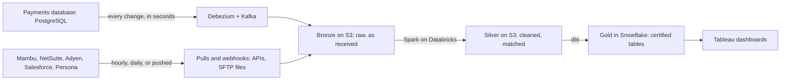

# Overview

## The problem in two sentences

Our fintech's data lived in six systems that didn't agree, so finance, risk and product each gave a different answer to "how much did we make?" Reports were stitched together by hand, arrived late, and couldn't be traced back to their source when auditors asked.

## The company

We're a mid-size fintech with two products: **card payments** for small businesses (merchants like Jane's Bakery take card payments through us) and **loans** for consumers and small businesses. We grew fast and bought or built a new system for every new need, so our data grew in pieces with no shared design.

### Our six systems

| System | What it holds | How we get data out | Scale |
|---|---|---|---|
| **Payments database:** our own app, PostgreSQL on AWS (Amazon Web Services) RDS (Relational Database Service) | Every card payment, refund and chargeback (a customer disputing a charge) | CDC (Change Data Capture): read every change from the database's own log, within seconds | ~5 million payments a day |
| **Mambu:** lending software we bought | Loans, repayment schedules, balances | API (Application Programming Interface), every hour | ~500,000 active loans |
| **NetSuite:** our ERP (Enterprise Resource Planning) system, used for accounting | The general ledger: the official book of all money in and out | API (SuiteQL queries), daily | Card fees and loan income are booked as one total a day each, not one line per payment |
| **Adyen:** our card processor, which moves the money between banks | What actually landed in our bank account, and the fees Adyen deducted | CSV (Comma-Separated Values) files over SFTP (Secure File Transfer Protocol), daily | One report each time Adyen pays money into our bank account, usually daily. ~5 million rows a day: one row for every payment, refund and chargeback in that payout |
| **Salesforce:** our CRM (Customer Relationship Management) tool | Customer and business details | Bulk API, daily | ~1 million customers |
| **Persona:** identity checks | KYC (Know Your Customer) and KYB (Know Your Business) results: is this person or business who they claim to be, and is anyone on a sanctions list? | Webhooks (Persona calls us when a check finishes), plus a daily API pull | ~10,000 checks a day: about 3,000 applicants, each with several checks (ID document, selfie, sanctions list; a business adds each of its owners), including the ones we turn down |

Two of these matter more than they look:
- **Adyen** is the only place that says what fee it took on each payment. Without that fee we can't work out what we actually earned, so the nightly certified build waits for Adyen's files (`04`, `05`).
- **Persona's** data is sensitive. It's joined onto customers so compliance can run AML (Anti-Money Laundering) monitoring, linking money movements to verified people, but identity details stay masked for everyone else (`08`).

### The systems don't agree

Every system has its own IDs, clocks and words for the same thing:

| | One system says | Another says | Really |
|---|---|---|---|
| **Customer** | Salesforce: `CUST-4821` | Mambu: `12345` | Same customer, nothing links them |
| **Time** | Payments: `14:02 UTC` (Coordinated Universal Time) | Adyen's file: `15:02`, with a separate time-zone column saying `CET` (Central European Time) | Same moment |
| **Status** | Payments: `disputed` | Adyen's file: `Chargeback` | Same state, so a program comparing them sees no match |

## What was going wrong

1. **Three answers to "how much did we make?"** Each team knew what its own number meant. But every team's report called that number "revenue", and each was built from the one system that team worked in:

   | Team | What it called revenue | From | Last month |
   |---|---|---|---|
   | Product | Payment volume: all \$100 when a customer pays Jane's Bakery \$100, though most of it is Jane's money | Payments database | \$4.9B |
   | Finance | What we keep: our \$3 fee minus Adyen's \$2.10 cost, so \$0.90 | NetSuite | \$74M |
   | Risk | Loan interest and fees only, with no card payments at all | Mambu | \$32M |

   Put side by side in a leadership meeting, "revenue" had three values, and no single report covered the whole company.
2. **Month-end close by hand.** Getting one true number meant stitching the systems together. Every month an analyst lined up daily totals from NetSuite, Mambu and Adyen in Excel. Whenever two totals disagreed, they dug through single payments and loan repayments to find out why. Closing the books took about 10 days.
3. **Late data.** Payments reached analysts a day after they happened. A fake merchant once signed up and took \$40,000 on stolen cards in one hour. Seen within minutes, we could have frozen the account before paying it. We saw it the next day instead, after the merchant had been paid and had disappeared. The real cardholders got their money back, and the loss was ours.
4. **Painful audits.** We were preparing to go public, which brings SOX (Sarbanes-Oxley Act), the US law that makes public companies prove their financial numbers. An auditor wants to see where the \$74M revenue figure came from and that nobody changed it along the way. All we had was a spreadsheet someone had built by hand.
5. **Personal data everywhere.** The repayments dug out for those month-end spreadsheets came with borrowers' names, emails and bank account numbers, and the spreadsheets were passed around by email. As a lender, we must protect exactly that data under the FTC (Federal Trade Commission) Safeguards Rule.

## The goal

One trusted platform for the company's numbers. Two rules shaped every choice: never slow down the live payments database, and financial numbers must reconcile exactly, even if that makes them slower.

**How we'd know it worked:**
- Month-end close down from about 10 days to about 3.
- Payments visible to analysts within minutes, not a day.
- One certified definition each for net revenue, active customers and default rate.
- Audit questions answered from recorded lineage in hours, not weeks.

## The solution

One data platform on AWS. Data comes in on two paths, is cleaned in three stages (Bronze, Silver, Gold), and ends up in Tableau. Bronze and Silver are files on S3 (Simple Storage Service); Gold is built with dbt (data build tool) in Snowflake.

## One payment's trip through the platform

A customer pays Jane's Bakery \$100 by card on 14 Feb. It's transaction `T-1001`.

1. **Seconds later:** Debezium reads the new row from the database's log and puts it on Kafka. The risk team watches the same Kafka stream, so they see it right away. Within a few minutes, a Kafka connector writes it to Bronze.
2. **At the next 15-minute run:** a Spark job merges it into `silver.transactions` under Jane's one customer ID, `C-000981`.
3. **A few minutes after that:** it appears on the live "today's payments" dashboard as \$100, pending. This number is provisional: no fees yet.
4. **A day or two later:** Adyen pays the money out to us, and the settlement report for that payout shows Adyen deducted \$2.10. That night dbt updates `fct_payments` in Gold: we earned **\$0.90**.
5. **At month-end:** February's certified net revenue includes Jane's \$0.90 and matches NetSuite. Finance can click any figure down to `T-1001`.

## My role

I was the lead data engineer and owned the architecture: I chose the tools and layers, set the data standards, guided the team that built it, and worked with finance, risk and compliance to agree what "correct" means.
