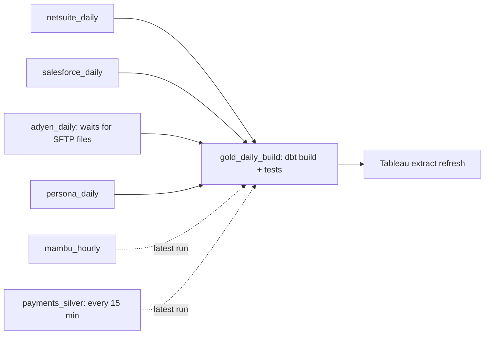

# Orchestration — Airflow

- **Why this tech:** the pipeline has steps in five different systems: vendor APIs (Application Programming Interfaces) and SFTP (Secure File Transfer Protocol), S3, Databricks, and Snowflake/dbt. Something has to run each step at the right time, in the right order, retry it when it fails, and tell a person when it can't recover. Apache Airflow does that, and its workflows are plain Python checked into Git, so every schedule change is reviewed like code. We run it as Amazon MWAA (Managed Workflows for Apache Airflow) (confirm), so we don't operate Airflow's servers ourselves. We rejected Databricks Workflows and the dbt Cloud scheduler: each only sees its own tool, and our chains cross tools (pull → Spark → dbt → Tableau).
- **What Airflow does *not* do:** it holds no data, and it doesn't run the Payments CDC (Change Data Capture) stream. Debezium and the Kafka Connect S3 Sink are always-on connectors (`02-ingestion-debezium-kafka-scheduled-pulls.md`), so Airflow only schedules the batch work around them.

## The words you need

- **DAG (Directed Acyclic Graph):** one workflow. It's a set of tasks with arrows showing what must finish before what, and no loops.
- **Task:** one step in a DAG, e.g. "pull Mambu" or "run the Silver job."
- **Operator:** a ready-made task type, e.g. `DatabricksRunNowOperator` starts a Databricks job and waits for it to finish.
- **Sensor:** a task that waits for something to happen, e.g. `SFTPSensor` waits until Adyen's files appear.
- **Dataset (called Asset in Airflow 3):** a named piece of data a task produces, e.g. `silver.settlements`. A DAG can be scheduled to start when its datasets are updated, instead of at a fixed time.

## DAG structure and scheduling

All schedules are in UTC (Coordinated Universal Time), so daylight-saving changes never shift a run (confirm times).

| DAG | Schedule | What it runs, in order |
|---|---|---|
| `payments_silver` | Every 15 minutes | Databricks Payments Silver job (`03-processing-spark-databricks.md`). It reads everything new since its bookmark. → dbt build of the provisional `payments_intraday` table (`05`) |
| `mambu_hourly` | Every hour | Pull Mambu → row-count check → Databricks Silver job for loans |
| `netsuite_daily` | 01:00 | Pull NetSuite → row-count check → Silver job |
| `salesforce_daily` | 01:30 | Bulk API (Application Programming Interface) pull → row-count check → Silver job |
| `adyen_daily` | 02:00 | `SFTPSensor` waits for the settlement files (normally 02:00–04:00) → download with checksum manifest → Silver job |
| `persona_daily` | 03:00 | 48-hour reconciliation pull → Silver job |
| `gold_daily_build` | When all daily Silver datasets have updated | `dbt build` in Snowflake (models plus tests) → refresh Tableau extracts |



- **Gold waits for data, not for a clock.** `gold_daily_build` is scheduled on the four daily Silver datasets. If Adyen's files land late, Gold simply starts later, instead of building at a fixed 05:00 on half the data. The hourly and 15-minute sources don't gate it; Gold uses their latest successful run.
- **Deadline:** finance needs Gold and the dashboards by 06:00 Eastern (confirm). A deadline alert fires if `gold_daily_build` hasn't finished by then, so on-call hears about it before finance does. This is the SLA (Service Level Agreement) from the glossary in practice.
- **One run at a time:** every DAG has `max_active_runs = 1` and `catchup = False`. Each run reads everything new since its bookmark, so after an outage one run catches up fully; there's no need to replay every missed slot (see Gotchas).
- **Vendor rate limits:** all Mambu tasks share an Airflow pool (a cap on how many tasks may run at once) of 2 slots, keeping us under Mambu's ~10 requests/second limit (confirm), whatever else is running.

The core settings, abridged:

```python
default_args = {"retries": 3, "retry_exponential_backoff": True,
                "on_failure_callback": alert_on_call}

with DAG("gold_daily_build", schedule=[SILVER_NETSUITE, SILVER_SALESFORCE,
         SILVER_SETTLEMENTS, SILVER_PERSONA], max_active_runs=1, catchup=False,
         default_args=default_args):
    ...
```

## Failure handling, retries, and alerting

- **Retries first:** every task retries 3 times with growing gaps (exponential backoff), because most failures are temporary: a vendor API timing out, or a Databricks cluster taking too long to start.
- **Tasks are safe to re-run (idempotent):** pulls land in new run-stamped folders, and Silver uses `MERGE` (`02`, `03`). So a retry or a manual re-run can never double-load data.
- **A wrong row count is a failure, not a success.** Each pull's row-count check (`02`) fails its task when the count is far outside the recent average, so the downstream Silver job and Gold don't run on bad data.
- **dbt tests decide whether Gold publishes:**
  - Tests with `severity: error`, such as "transaction IDs are unique," fail the build. Tableau then isn't refreshed, and dashboards keep yesterday's trusted numbers rather than showing wrong ones.
  - Tests with `severity: warn` are business findings that don't block anything.
- **Who gets told what:**

| Event | Goes to |
|---|---|
| A task fails after all retries | Slack `#data-alerts` |
| `gold_daily_build` fails, or the 06:00 deadline is missed | Page to on-call (PagerDuty) |
| A sensor times out (e.g. no Adyen files by 06:00) | Page to on-call; Gold proceeds as in Gotcha 1 |

## Gotchas (confirm — illustrative until matched to a real incident)

- **A late file published incomplete revenue.**
  - **What happened:** an early version of `gold_daily_build` ran at a fixed 05:00. On a US bank holiday, Adyen's settlement files arrived at 07:30. Gold built without that day's processor fees, and the 06:00 dashboards overstated net revenue for one day before anyone noticed.
  - **Fix:** Gold is now scheduled on the Silver datasets, so it waits for the data. If Adyen still hasn't arrived by the deadline, Gold publishes everything else, marks settlement-based figures as "awaiting settlement data" on the dashboard, and pages on-call, rather than showing a confident wrong number.
- **Catch-up stampede.**
  - **What happened:** `payments_silver` was paused for 6 hours during a maintenance window. With `catchup = True` (the old default), un-pausing launched all 24 missed 15-minute runs at once. They started 24 Databricks clusters at the same time, which spiked cost, and they competed to write to the same Silver table, so several failed on write conflicts.
  - **Fix:** `catchup = False` and `max_active_runs = 1` on every DAG. Since each run reads everything new since its bookmark, the first run after un-pausing catches up fully on its own.

## Compliance and security

- **SOX (Sarbanes-Oxley Act):** Airflow's run history records every run of the financial pipelines: when it ran, whether it succeeded, and who triggered or re-ran anything by hand. Auditors can see the nightly NetSuite and Gold runs as evidence the process ran as designed. In production, manual re-runs and task clears are limited to the data-engineering role through Airflow's RBAC (Role-Based Access Control).
- **Secrets:** API keys and SFTP credentials come from AWS (Amazon Web Services) Secrets Manager through Airflow's secrets backend (`02`). They're never stored in DAG code or in Airflow's own database.
- **PCI-DSS (Payment Card Industry Data Security Standard) and KYC (Know Your Customer) data:**
  - Payments data never passes through Airflow; it flows through the CDC connectors.
  - Vendor pull tasks stream responses straight to S3, without keeping copies on the Airflow workers.
  - Task logs never print record contents, so no card tokens or Persona identity data end up in Airflow logs.
