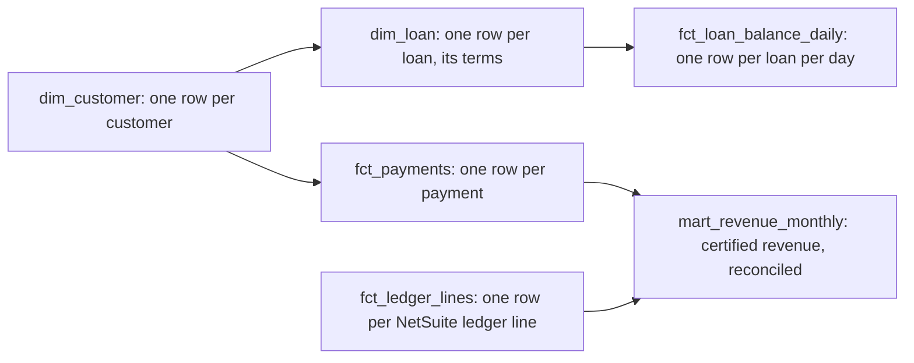
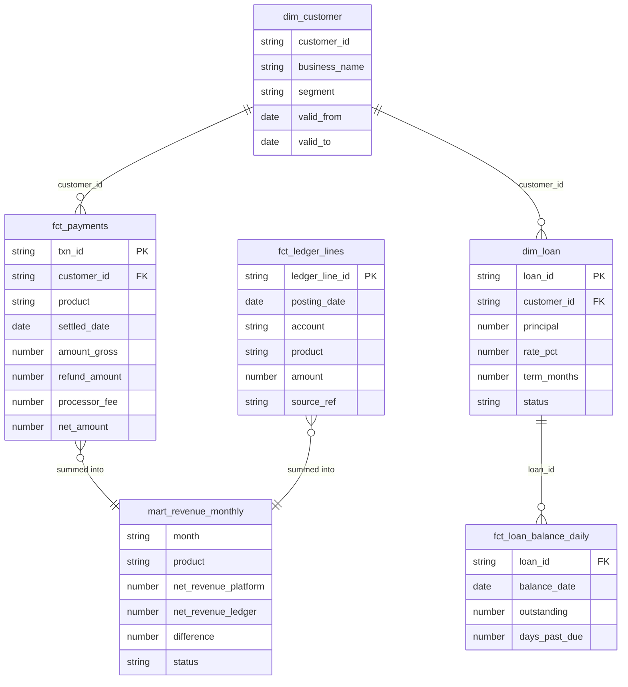

# Storage and Warehouse — S3 (Bronze, Silver) and Snowflake + dbt (Gold)

This layer is where data lives at each stage. Bronze and Silver are files in the data lake on Amazon S3 (Simple Storage Service). Gold is the certified set of business tables in Snowflake, built with dbt (data build tool).

## Storage: the data lake on S3

- **Why S3:** it's cheap, practically unlimited, and every tool in the pipeline can read it (Kafka Connect, Airflow tasks, Spark, Snowflake). Raw history costs pennies per GB (gigabyte) per month, so we keep everything rather than decide up front what might be needed later.
- **Layout:** one bucket (top-level folder) per layer, organised by source and date so tools only read the dates they need.

| Layer | Bucket (confirm) | Format | Kept for |
|---|---|---|---|
| Bronze | `s3://company-raw/<source>/date=.../` | As received: JSON (JavaScript Object Notation), CSV, Parquet from the CDC (Change Data Capture) sink | 7 years (confirm) |
| Silver | `s3://company-silver/<table>/` | Delta tables (`03-processing-spark-databricks.md`) | Current state, plus 30 days of history |

- **A "table" on S3 is just files.** S3 only stores files. `silver.transactions` is really a folder of data files plus a small index folder saying which files make up the table right now:
  ```
  s3://company-silver/transactions/
    _delta_log/          ← the index
    part-0001.parquet    ← data files
    part-0002.parquet
  ```
- **Files are never edited; changes add new files.**
  - **New payments:** a new data file is written, and the index adds it, e.g. "version 41: add `part-0007`."
  - **An update,** like T-1001 going from pending to settled: a new file holds the settled row, and the index swaps it in, e.g. "version 42: remove `part-0003`, add `part-0008`."
  - **Reading:** readers follow the latest index entries, so they see only current files. Old files stay for history until a clean-up job deletes them.
- **How Silver is organised:** one bucket with many tables, one folder each, grouped by **business thing**, not by source system.
  - **Combined:** some tables merge several sources. `silver.customers` combines Salesforce, Mambu, and the payments database into one record per customer (`C-000981`). Silver is where the systems first agree.
  - **Mostly one source:** `silver.transactions` (payments database), `silver.refunds`, `silver.settlements` (Adyen), `silver.ledger` (NetSuite), `silver.loans` (Mambu).
- **Bronze has no table format.** It's files exactly as received (JSON, CSV, Parquet), one folder per source and date. Bronze is only ever added to, never updated, so it doesn't need the index; only Silver, where rows change, does.
- **Lifecycle rules to control cost:** Bronze moves to cheaper archive storage (S3 Glacier) after 90 days. It's rarely read after that, but must still exist for audits and replays.
- **Bronze can't be edited:** Bronze has S3 Object Lock turned on, a setting that blocks anyone, even an admin, from changing or deleting files before their retention date. That's what lets us tell an auditor "this is exactly what the source sent us."
- **Encryption:** all buckets are encrypted with keys managed in AWS KMS (Key Management Service), and access is per role. For example, only the ingestion role can write to Bronze, and the Persona folders have their own narrower role (`02`).

## Getting Silver into Snowflake without copying it

**The decision:** Snowflake reads Silver **in place**; we don't copy it. Snowflake is told "this table lives in these S3 files" and reads those files directly whenever it's queried. It's like sharing one Google Doc link instead of emailing everyone their own copy.

**How:** a **table format** is the index described above: it says which data files make up the table now, plus the history of changes, so plain files behave like a real table. Three names matter:

| | What it is | Example | Its job here |
|---|---|---|---|
| **Delta Lake** | Databricks' open table format; its index is the `_delta_log` folder. It supports updates (`MERGE`), history, and schema checks | Spark merges T-1001's `settled` version into `silver.transactions`, logged as version 42 | Silver is written as Delta, so Spark can update and de-duplicate safely (`03`) |
| **Apache Iceberg** | Another open table format, read by many engines (Snowflake, Spark, Trino, Athena). Its index also stores statistics, such as the date range in each file | Snowflake queries February, sees from the index which files hold only January, and skips them | The "language" Snowflake uses to read Silver in place |
| **UniForm** (Universal Format) | A Delta setting that, after each Delta change, also writes Iceberg index files for the same data files | Spark commits version 42; UniForm writes matching Iceberg metadata, so Snowflake's next read sees `settled` (after a short delay, confirm) | The bridge: one copy of the data, readable by both Spark and Snowflake |

In Snowflake, the Silver tables are registered as Iceberg tables in a `silver` schema (confirm).

**Why:** copying would mean two Silvers that could fall out of step, a sync job, and double the storage bill. Reading in place gives one Silver, with no sync.

**Trade-off:** Snowflake reads its own native tables faster than outside files. So dbt reads Silver once, while building Gold, and stores **Gold as native Snowflake tables**. Dashboards only ever hit the fast native tables.

**Where we *do* copy into Snowflake:**
- **Building Gold** writes transformed data into Snowflake's own storage, for speed.
- **Small reference files,** like finance's CSV mapping products to accounts, are uploaded to S3 and loaded with Snowflake's `COPY INTO` command (confirm).
- **If Silver couldn't be read in place,** the standard tool would be **Snowpipe**, Snowflake's auto-loader, which copies each new S3 file into a table as it lands.

## Warehouse: Gold in Snowflake

- **What Snowflake is:** a cloud data warehouse, a database service built for analytics that we rent. It stores the tables, provides the machines that run queries, runs the SQL (Structured Query Language), and handles security. You *can* type SQL into its web screen, but our build SQL lives in Git and dbt sends it.
- **Who queries it:**
  - **Tableau** fetches its numbers from Snowflake by running SQL; every refresh is a query.
  - **dbt's** nightly build is the heaviest work.
  - **Finance analysts** run checks during month-end close.
  - **Risk** asks ad-hoc exposure questions ("loans 30+ days late, by segment").
  - **Data science** pulls training data.
- **Why Snowflake:** all of those hit it at once. Snowflake separates storage from compute: each workload gets its own warehouse (see Cost below), so the 08:00 finance dashboards never slow down an analyst's big query. It also has the governance features this story needs: masking, Time Travel, cloning (see Compliance).
- **What dbt is:** a tool, not a language; the language is SQL.
  - Each Gold table is a `SELECT` query in its own file, e.g. `mart_revenue_monthly.sql`.
  - dbt works out the build order from which tables each query uses, sends each query to Snowflake (which creates the table), then runs the tests listed next to it.
- **Why dbt, and how Git fits:** "how is revenue calculated?" is answered by pointing to one reviewed file, not someone's memory. A change goes like this:
  1. An engineer edits the file and opens a pull request (a request for a teammate to review).
  2. An automatic check runs dbt and its tests on a test copy of the data.
  3. The reviewer approves.
  4. That night, Airflow runs dbt with the merged files.
  Git records who changed what, and why.

### Schema and modelling approach

**Star schema:** we use a dimensional model, the standard layout for reporting.
- **Fact tables** hold the events we measure, one row per event.
- **Dimension tables** hold the context around them.
- Each fact table has a stated **grain**: what exactly one row means. It tells you how the numbers may be added up.
  - In `fct_loan_balance_daily`, one row is one loan on one day.
  - **Summing across loans** for one day is right: on 28 Feb, L-778 owes \$49,410 and L-905 owes \$18,300, so \$67,710 is owed in total.
  - **Summing across days** is wrong: each loan appears once per day, so "total owed in February" would come out about 28 times too big. A balance is a snapshot, so across time you take one day (e.g. month-end) or an average.
  - Payments are different: each row is a separate event, so summing across days is fine.
- **Name prefixes:**
  - `fct_` is a fact, a list of events.
  - `dim_` is a dimension, a descriptive "card" about a customer or loan.
  - `mart_` is a **data mart**: a ready-made, already-summarised table for one business use. Facts and dimensions are the ingredients; the mart is the prepared meal that dashboards read directly, instead of adding up billions of payment rows.



Every fact table also links to `dim_date` (one row per day, with month, quarter, and fiscal period). It's left out of the picture to keep it readable.

| Gold table | Grain | Built from (Silver) | Plain meaning, with Jane's example |
|---|---|---|---|
| `fct_payments` | One payment | `silver.transactions` + `silver.refunds` + `silver.settlements` | Every payment with money in, refund, Adyen fee, and net. T-1001: \$100 gross, \$5 refund, \$3 fee, \$92 net |
| `fct_loan_balance_daily` | One loan, one day | `silver.loans` | A daily snapshot of every loan: how much is still owed, how late. L-778 on 28 Feb: \$49,410 owed, 0 days late |
| `fct_ledger_lines` | One ledger line | `silver.ledger` (NetSuite) | Accounting's official book entries, including the line booking Jane's payment |
| `dim_customer` | One customer | `silver.customers` | One card per customer: C-000981, Jane's Bakery LLC, small business, joined March 2025 |
| `dim_loan` | One loan | `silver.loans` | One card per loan: L-778, \$50,000, 12.5%, 48 months |
| `mart_revenue_monthly` | One month, one product | `fct_payments` + `fct_ledger_lines` | **The certified revenue number**, checked against accounting. February card payments include Jane's \$92 and match NetSuite |
| `payments_intraday` | One payment, today only | `silver.transactions` | **Provisional** gross volume and payment counts, refreshed every 15 minutes (see below) |

**The tables in detail.** Each table's columns, and the key columns that link them:



(PK, primary key: the column that identifies each row. FK, foreign key: a column pointing to another table's key. A payment joins to the customer version valid on its date. Every date column also links to `dim_date`.)

Sample rows (illustrative, confirm):

| `fct_payments` | txn_id | customer_id | product | settled_date | gross | refund | fee | net |
|---|---|---|---|---|---|---|---|---|
| | T-1001 | C-000981 | card_payments | 2026-02-15 | 100.00 | 5.00 | 3.00 | 92.00 |
| | T-1002 | C-001207 | card_payments | 2026-02-15 | 40.00 | 0.00 | 1.20 | 38.80 |

| `fct_ledger_lines` | ledger_line_id | posting_date | account | amount | source_ref |
|---|---|---|---|---|---|
| | NS-55012 | 2026-02-15 | 4000 Revenue | 100.00 | T-1001 |
| | NS-55013 | 2026-02-15 | 5100 Processor fees | −3.00 | T-1001 |
| | NS-57001 | 2026-02-20 | 4010 Refunds | −5.00 | T-1001 |

| `mart_revenue_monthly` | month | product | net (platform) | net (ledger) | difference | status |
|---|---|---|---|---|---|---|
| | 2026-02 | card_payments | 1,842,310.00 | 1,842,310.00 | 0.00 | reconciled |

- **The certified revenue model is the heart of problem #1.**
  - `mart_revenue_monthly` computes net revenue once: gross − refunds − Adyen fees. Jane's \$100 payment counts as \$92.
  - It then compares that month's total with NetSuite's ledger. Any gap must be explained by a known timing difference (e.g. a refund booked in the next month). Anything larger fails a dbt test.
  - Finance signed off this model, and that sign-off is what "certified" means.
  - **Why not just take revenue from NetSuite?**
    - The ledger is summarised and has no customer or segment detail, while product and risk need to drill down to payments.
    - It arrives once a day and is adjusted during close.
    - Two independent sources agreeing is the check itself: when they differ, something is broken (a missing refund, a payment never booked), and we find it at close instead of an auditor finding it.
- **Fresh data during the day (provisional, not certified).**
  - `00` promises transaction data to analysts within minutes, but certified net revenue can't be final the same day: it needs Adyen's fees and NetSuite's ledger, which arrive once a day.
  - So a small dbt model, `payments_intraday`, rebuilds every 15 minutes from `silver.transactions`, right after each Silver run (`04`). It holds today's gross volume and payment counts only, and is clearly labelled provisional.
  - Certified revenue stays nightly.
- **dbt layers:**
  - **staging:** light renaming over the Silver tables;
  - **intermediate:** joins, e.g. payment + refund + settlement;
  - **marts:** the Gold tables above.
- **History where it matters (slowly changing dimension, type 2).**
  - **The problem:** Jane's Bakery is "small business" in March and grows to "mid-market" in June. If we simply overwrite the segment, March's revenue would move under mid-market, and a report finance already signed off would change after the fact.
  - **The fix:** a **dbt snapshot** compares customer data on every run and records each change with dates, so March's payments join to the version valid in March:

    | customer | segment | valid from | valid to |
    |---|---|---|---|
    | C-000981 | small business | 2025-03-02 | 2026-06-01 |
    | C-000981 | mid-market | 2026-06-01 | (current) |

  - **Type 1** also exists: it overwrites and keeps no history. These are just numbered methods, not "errors." To choose, ask "was the old value ever true?"
    - **No, it was a mistake:** a business name typed as "Janes Bakry LLC," or a product mapped to the wrong category. That's type 1: overwrite, so every report, past ones included, shows the corrected value.
    - **Yes, it was true for a while:** the segment. That's type 2: keep history.
- **Tests on every build:**
  - `txn_id` (transaction ID, e.g. `T-1001`) is unique and never empty, so no payment is counted twice.
  - Every payment's `customer_id` exists in `dim_customer`.
  - `status` is only `pending`, `settled`, `failed`, or `disputed`. If a word like "in process" slips through a missed mapping, the test fails, instead of that payment quietly vanishing from every "settled" total.
  - **Revenue reconciliation:** each month's Gold net revenue matches the NetSuite ledger. Small gaps with a known cause, like a refund booked the next month, are allowed; anything bigger fails.
  - All are `severity: error`. If one fails, the build fails and Airflow stops before refreshing Tableau, so dashboards keep yesterday's correct numbers. The failure is posted to Slack `#data-alerts` and pages on-call (`04-orchestration-airflow.md`). `severity: warn` results only get a Slack summary.

### Cost and performance tuning

**The terms:**
- **Warehouse:** in Snowflake a warehouse is *not* storage. It's a rented group of computers that runs queries.
- **Size:** extra-small, small, medium, and so on. Each step up doubles the machines and the cost: 1, 2, 4 credits an hour.
- **Credit:** Snowflake's billing unit (price per credit depends on the contract, confirm).
- **Auto-suspend:** a warehouse switches itself off after 60 seconds with no queries, and back on in about a second when one arrives.
- **Scale out:** when 100 people open dashboards at 08:00, a warehouse can start extra copies of itself so nobody queues, then shrink back.

| Warehouse (confirm) | Used by | Size | Notes |
|---|---|---|---|
| `TRANSFORM_WH` | dbt nightly build | Medium | Runs about 40 minutes a night (≈ 2.7 credits), then pauses |
| `BI_WH` | Tableau | Small, scales out to 3 copies at the 08:00 peak | Mostly serves extract refreshes |
| `ADHOC_WH` | Analysts | Extra-small | Pauses after 60 seconds idle |
| `INTRADAY_WH` | The 15-minute `payments_intraday` build | Extra-small | About a minute per run, then pauses |

- **`TRANSFORM_WH` vs `BI_WH`:** think of a kitchen and a dining room.
  - `TRANSFORM_WH` is the kitchen: it *builds* (writes) Gold, with a few heavy jobs overnight.
  - `BI_WH` is the dining room: it *serves* (reads) many small dashboard requests from many people in the morning.
  - Keeping them apart means the nightly build never slows the morning, and we can see what each costs.
- **Pausing:** every warehouse pauses itself after 60 seconds idle, so we don't pay for machines doing nothing.
- **Resource monitors** are budget alarms on a warehouse. For example, `ADHOC_WH` gets 300 credits a month (confirm): at 80% (240) we get an email, and at 100% Snowflake suspends it. Only ad-hoc can be switched off automatically. Suspending the nightly build or Tableau would break finance's dashboards, so those only send the email.
- **Incremental models.** dbt can build a table two ways:
  - **Full rebuild:** recompute it from all of Silver every night. That's fine for small tables like `dim_loan` (500,000 rows).
  - **Incremental:** keep the existing table and only process what's **new or changed**. That's essential for `fct_payments` (about 1.8 billion rows a year, confirm), where a nightly rebuild would be slow and expensive.
  - **How "changed" is found:** each Silver row has a `last_changed` time. Each night dbt takes payments that changed since the last build: today's new payments, *plus* older payments that got a refund or settlement today. It inserts the new ones and updates the changed ones (`MERGE`). *Example:* T-1001 was paid on 14 Feb and refunded on 20 Feb, so on the 20 Feb build it counts as changed and its row goes from \$97 to \$92.
  - **Lookback window:** a safety margin. dbt reprocesses everything changed in the last **3 days** (confirm), not just since exactly the last build, to catch rows that arrived late or slipped past a failed run. Re-merging them is harmless, because `MERGE` never duplicates.
- **Clustering:** Snowflake stores a table in many small chunks. If February's payments were scattered across every chunk, a February query would open them all. Clustering `fct_payments` by settlement date keeps each day's payments together, so a February query opens only February's chunks. It's like filing receipts in folders by date instead of in one box; the same idea as the date folders in Bronze.
- **Tableau extracts:** Tableau can either ask Snowflake *live* on every filter click (a query, and a cost, each time) or keep its own snapshot, an *extract*. An extract works like Tableau's own cache, refreshed on our schedule. We refresh extracts once after each nightly build, so clicks read Tableau's copy: faster, and free on the Snowflake side. Gold changes only once a day, so the extract is just as fresh.

## Gotchas (confirm — illustrative until matched to a real incident)

- **Late refunds didn't reach Gold.**
  - **What happened:** the first version of the incremental `fct_payments` model chose rows by *payment date*: "payments made since the last build." Jane's \$5 refund on 20 Feb belonged to a 14 Feb payment, so it was never picked up, and the row stayed at \$97 instead of \$92. February's net revenue came out slightly high, and the reconciliation test caught the gap with NetSuite at close.
  - **Fix:** the model now chooses rows by *last changed* time (of the payment, its refund, or its settlement) with a 3-day safety window, as described under Incremental models. A refund weeks later still updates its payment, because the refund itself changes that day.

## Compliance and security

- **SOX (Sarbanes-Oxley Act):**
  - **Who can write Gold:** only the dbt service account, through the reviewed Git process. No person can edit a Gold table by hand.
  - **Time Travel:** Snowflake keeps old versions of changed or deleted data for a set period (1 day by default, up to 90 days on its Enterprise edition, confirm ours). Within that window we can:
    - query a table as it was at a past moment, e.g. "what did the revenue mart show at 09:00 last Monday, when finance read it?";
    - restore a table after a bad change, e.g. a dbt deploy that wiped a column;
    - bring back a dropped table.
    After the window, Snowflake holds a further 7-day emergency backup (Fail-safe) that only its support team can restore.
  - **Month-end freeze:**
    - **"Close"** is the first few days of each month, when finance finalises and signs off the previous month's numbers.
    - **The problem:** February's data can still change afterwards (a late refund, a correction), so Gold's February figures can shift after sign-off. Time Travel reaches back only 90 days, so it can't answer an auditor in July.
    - **The fix:** on close day we take a **zero-copy clone** of Gold, an instant copy made with one command. It points at the same stored data instead of duplicating it, so it costs almost nothing; only later changes take new space. It's named e.g. `gold_close_2026_02` and made read-only.
    - **Result:** when the auditor asks "what did February say at close?", we open it and show the exact tables finance signed off.
    - **The clone never changes; live Gold does.** A late February refund arriving in March updates live Gold, and finance books it as an adjustment in March rather than rewriting February. The clone answers "what did we sign off?", live Gold answers "what's true now?", and the adjustments explain the difference. "Zero-copy" refers to storage, not content: the clone shares the stored data with live Gold, and Snowflake keeps the old chunks for the clone as live Gold changes, so we only pay for what changed.
- **KYC/AML (Know Your Customer / Anti-Money Laundering):** identity columns from Persona in `dim_customer` carry Snowflake masking policies. Anyone without the compliance role sees `***MASKED***`, matching the column masks in `03-processing-spark-databricks.md`.
- **PCI-DSS (Payment Card Industry Data Security Standard):** Gold holds only card tokens and the last 4 digits, never full card numbers. That keeps Snowflake out of the card-data audit.
- **Access by role (RBAC, Role-Based Access Control):** finance, risk, and analysts each get a role that can read the Gold marts they need. Write access belongs only to the service accounts.
