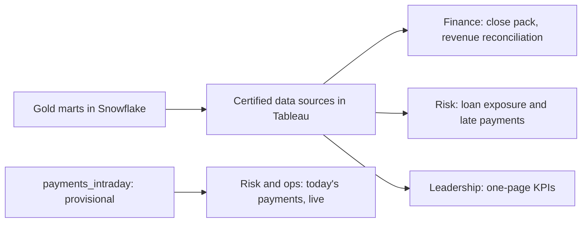

# Serving and Analytics — Tableau

This is the layer people actually see: dashboards built on the certified Gold tables from `05-storage-warehouse-s3-snowflake.md`. Its job is to get the one agreed number in front of finance, risk, and leadership, quickly, and to keep it agreed.

- **Why Tableau:**
  - Finance already used it and knew it, so adoption was immediate (confirm).
  - It lets non-programmers build and filter dashboards themselves.
  - It has the controls this story needs: shared certified data sources, row-level security, and an API (Application Programming Interface) to trigger refreshes.
  - We run Tableau Cloud (Tableau's hosted version), so there are no servers to manage (confirm).
- **What we rejected:**
  - **Looker:** its strength is defining metrics in its own modelling language, but our metric definitions already live in one place, dbt in Gold. A second definition layer would bring back problem #1.
  - **Power BI:** it fits best in a Microsoft/Azure shop, and we're on AWS.

## Who consumes this data and how

| Audience | Dashboard | Built on (Gold) | Refreshed | Example question it answers |
|---|---|---|---|---|
| **Finance** | Month-end close pack + revenue reconciliation | `mart_revenue_monthly` | Nightly | "Does February's net revenue match NetSuite? If not, which product and by how much?" |
| **Risk** | Loan exposure and late payments | `fct_loan_balance_daily` + `dim_loan` | Nightly | "How much is owed on loans 30+ days late, by segment?" |
| **Leadership** | One-page KPIs (Key Performance Indicators) | `mart_revenue_monthly` (net revenue) + `mart_kpis_monthly` (active customers, default rate) | Nightly | "How are the three headline numbers trending?" |
| **Risk and operations** | Today's payments | `payments_intraday` | Every 15 minutes | "Is payment volume normal this afternoon?" |
| **Analysts** | Their own ad-hoc workbooks | Certified data sources only | Nightly | Anything new, using the same certified metrics |

The three leadership KPIs are exactly the "one certified definition each" from the success measures in `00-problem-statement.md`: net revenue, active customers, and default rate.

**What each one looks like in practice (illustrative, confirm):**
- **Finance:** on 3 March, closing February, the dashboard has one row per product.
  - **Card payments** match (\$1,842,310 on both sides), so there's nothing to do.
  - **Lending fees** are \$475 apart (ours \$211,940, NetSuite \$212,415), so finance clicks that row. It opens the Gold rows behind the gap, not Mambu: the fee and refund records (which came from Mambu through the pipeline) next to the matching NetSuite ledger lines.
  - **The cause, a timing difference:** two systems recorded the same refund on different days.
    - **Mambu** issued the \$475 fee refund at 23:30 on 28 Feb and recorded it that day. Our pipeline copied it, so in Gold it's February.
    - **NetSuite** isn't connected to Mambu. Each morning an accountant loads Mambu's daily fee report into NetSuite as one summary entry, after reviewing it. That report stops at 23:00 (confirm), so the refund went into the 1 March report, and NetSuite dated it 1 March.
    - Neither system is wrong. Our pipeline just copies both, and the reconciliation shows where they disagree.
  - Finance notes the gap as a known cause (the test allows it) and signs February off. The gap reverses in March. This check used to take an analyst days in Excel.
- **Risk:**
  - Loans are grouped by **days late** (days past due): how many days since a repayment was due and not paid. Tom's Tacos (L-905) had a payment due 16 Feb still unpaid on 28 Feb, so it's 12 days late.
  - The groups are 0–29, 30–59, 60–89, and 90+. 90+ is usually treated as default, unlikely to be repaid (confirm our definition), and the share of loans in it drives the default rate.
  - Filtering to small businesses shows \$1.2M owed on 84 loans that are 30+ days late.
  - Tom's Tacos isn't in that group yet, but it can be watched.
- **Leadership:** three tiles with trend lines. Net revenue \$2.05M (up 4% on January), active customers 410,112 (up 1.2%), default rate 2.3% (flat).
- **Risk and operations:** payments per 15 minutes today. 3,412 between 14:00 and 14:15 is normal (the usual range is 3,000–3,800). A drop to 900 at 14:30 shows an Adyen outage within 15 minutes.
- **Analysts:** someone builds "net revenue from customers who joined in 2025, by month."
  - They may build any chart, filter, or formula, but only from the certified data sources, which sit on the Gold marts. Never from Silver or raw tables.
  - New calculations *on top of* certified metrics are fine, e.g. "revenue per customer = net revenue ÷ active customers."
  - Re-creating a certified metric from its parts, e.g. their own "net revenue = gross − refunds," is not (see Gotchas).

## Key design decisions

- **Certified data sources: one definition, shared.**
  - **Two Tableau words:** a **data source** is the connection to the data plus the definitions of its fields. A **workbook** is the file where charts are built, like an Excel workbook.
  - **The problem without shared sources:** every workbook author connects straight to the Snowflake tables and types their own formulas. Twenty workbooks end up with twenty versions of "revenue," which is problem #1 all over again, this time inside Tableau.
  - **What we do:**
    - Data engineering creates one **published data source** per Gold mart, e.g. "Revenue (Certified)," connected to `mart_revenue_monthly`, with "Net revenue" and "Gross payment volume" already defined.
    - It's saved on Tableau Cloud, where everyone can *use* it but only data engineering can *change* it.
    - It carries Tableau's **Certified** badge, meaning "this is the official one."
  - **For an analyst:** they pick it from a list, drag "Net revenue" onto a chart, and automatically get the number where Jane's payment counts as \$92. There's nothing to type and nothing to get wrong.
  - **Why it's the last step:** Gold fixed the definitions in the warehouse. Certified data sources stop dashboards from redefining them at the very end.
- **Extracts for certified dashboards, live only for "today."**
  - Certified dashboards read **extracts**: Tableau's own snapshot of the data, which acts as a cache. Gold changes once a night, so a nightly extract is just as fresh, and every click is fast and free on the Snowflake side.
  - The today's-payments dashboard connects **live** to `payments_intraday`, because that table changes every 15 minutes. It's small (today only), so live queries on `BI_WH` stay cheap.
  - **Clicking never builds anything.** A filter click only reads data that's already there:
    - **Certified dashboards** read last night's extract (from the successful Gold build at about 05:00).
    - **The live dashboard** reads `payments_intraday` as of its last 15-minute rebuild.
    - New data arrives only through the pipeline, never because someone clicked.
  - **Two separate Airflow workflows feed these, because they need different data:**

    | | `payments_silver`, every 15 minutes | `gold_daily_build`, nightly |
    |---|---|---|
    | Needs | Payments only, which CDC (Change Data Capture) drops into Bronze constantly, outside Airflow | Every source, including Adyen fees and NetSuite, which arrive once a day |
    | Does | Databricks moves new payments into `silver.transactions`, then dbt rebuilds **only** `payments_intraday` | dbt rebuilds all certified Gold and runs every test, then the extracts refresh |
    | Result | Today's gross volume, provisional | Certified numbers |

    *Example:* Jane's 14:02 payment is in Bronze within seconds, in Silver after the 14:15 run, and on the live dashboard by about 14:19. It joins certified `fct_payments`, with fees and refunds, in the next nightly build.
- **Refreshed by Airflow, not by Tableau's own clock.**
  - Tableau can refresh extracts on its own timer, but a timer doesn't know whether Gold finished building correctly.
  - So the last step of `gold_daily_build` (`04-orchestration-airflow.md`) calls Tableau's REST API to refresh the extracts, and only after every dbt test passes.
  - If the build fails, the refresh never happens, and dashboards keep yesterday's correct numbers.
- **"Data as of" on every dashboard.** Each one shows when its data was last refreshed (e.g. "Data as of 17 Feb 2026, 05:12 ET"). Nobody has to guess whether they're looking at today's numbers.
- **Provisional is labelled as provisional.** The today's-payments dashboard carries a banner: "Provisional: gross volume only. Certified figures tomorrow by 06:00." People can use the fresh numbers without mistaking them for the official ones.
- **From any number down to the payments behind it.**
  - Finance can click a revenue figure and see the individual `fct_payments` rows behind it, e.g. February card payments → Jane's T-1001 at \$92.
  - That's how an auditor's "prove this number" question is answered in minutes (problem #4).
- **Row-level security: people see only their rows.**
  - A small entitlements table in Gold lists which user may see which customers. For example, a relationship manager sees only their own portfolio.
  - The certified data sources filter on it automatically, using the signed-in user's name.
- **Fast by design.**
  - Dashboards read the small, pre-summarised marts, not 1.8 billion payment rows.
  - We keep filters to the ones people actually use.
  - Our target is under 3 seconds per view (confirm).

## Gotchas (confirm — illustrative until matched to a real incident)

- **A second "revenue" crept back in.**
  - **First, two terms:**
    - **A workbook** is Tableau's file, like an Excel workbook. It holds sheets (one chart each), dashboards (several sheets on one page), a connection to data, and any formulas the author adds.
    - **A calculated field** is one of those formulas, typed inside the workbook, e.g. `Revenue = SUM([amount_gross])`.
  - **What happened:**
    1. A product analyst built a workbook, "Product Weekly," connected straight to `fct_payments` instead of the certified data source.
    2. In it they created a calculated field named **"Revenue,"** adding up the **gross** amount and ignoring refunds and fees. Jane's payment counted as \$100 there.
    3. It was useful, so it was shared widely, including with leadership.
    4. Leadership then had two dashboards side by side: "Product Weekly" said February revenue was \$2.18M (gross), and the certified KPI page said \$2.05M (net).
    5. The CFO (Chief Financial Officer) asked, "which one is right?", the exact question the platform was built to end.
  - **The cause:** the data wasn't wrong. A formula inside one workbook quietly redefined "revenue." It was problem #1 all over again, just one layer later.
  - **Fix:**
    - **A rule:** dashboards shared with leadership must use only the certified data sources. That's checked before they go into the leadership folder.
    - **A monthly automated scan:** Tableau's Metadata API (a way to ask Tableau what's inside every workbook) lists every calculated field. Any field named like "revenue," "GPV," or "active customers" is flagged to its owner.
    - **The outcome here:** the analyst had actually meant gross volume, which already exists as the certified field "Gross payment volume." They swapped it in under its correct name, and the two numbers stopped clashing.

## Compliance and security

- **PCI-DSS (Payment Card Industry Data Security Standard):** no card data reaches Tableau. Only tokens and the last 4 digits exist in Gold, and the data sources don't even include those.
- **KYC/AML (Know Your Customer / Anti-Money Laundering):** Persona identity columns are masked in Snowflake (`05`) and left out of every Tableau data source, so they can't appear on a dashboard.
- **SOX (Sarbanes-Oxley Act):**
  - Every financial figure comes from a certified data source on a tested Gold mart.
  - Every dashboard shows when its data is from.
  - Every number can be drilled to its payments.
  - Only data engineering can publish or change a certified data source.
- **Access:** people sign in with the company's single sign-on (one login for every work tool), and their Tableau permissions come from their team group. When someone leaves, removing their login removes their access.
