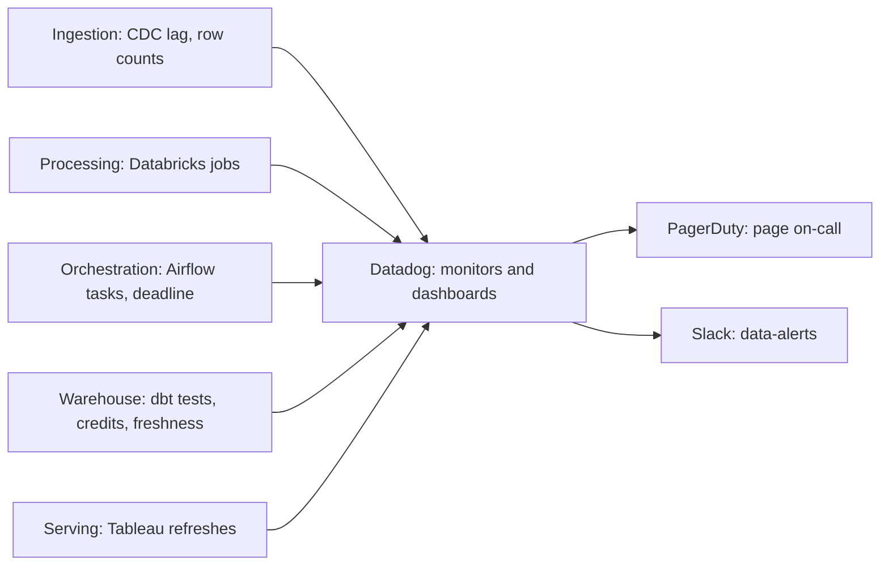

# Monitoring and Observability — Datadog

**Observability** means being able to tell, from the outside, whether the pipeline and its data are healthy, and why not when they aren't. **Monitoring** is the part that watches those signals and raises an alert when something goes wrong. This layer gathers every check described in `02`–`06` into one place, so one on-call engineer can see the whole pipeline.

- **Why Datadog:**
  - It's one service for metrics, logs, dashboards, and alerts across every tool we run, through ready-made integrations: AWS, PostgreSQL, Kafka, Airflow, Databricks, Snowflake.
  - It sends urgent alerts to PagerDuty (the phone-paging service for on-call) and the rest to Slack.
  - It's the most widely used tool of its kind across industries, so new engineers usually know it already.
- **What we rejected:**
  - **Prometheus + Grafana:** the free, open-source standard, very common where apps run on Kubernetes. We'd have had to run and scale those servers ourselves and wire up each tool, which is too much for a small data team.
  - **Amazon CloudWatch alone:** it sees AWS well, but not Snowflake or Databricks.

## The words you need

- **Metric:** a number tracked over time, e.g. "rows loaded per run" or "minutes since Gold last updated."
- **Log:** a text record of what a job did, e.g. "NetSuite pull finished: 64,832 rows."
- **Monitor:** a rule watching a metric, e.g. "alert if Gold is more than 26 hours old."
- **SLO (Service Level Objective):** the reliability target we hold ourselves to, e.g. "certified Gold ready by 06:00 on 99% of days." It's the measurable version of the SLA (Service Level Agreement) promised to finance.

## What's monitored

There are two kinds of health, and both matter:
- **Pipeline health:** "did the jobs run?"
- **Data health:** "is the data fresh and right?"

A pipeline can be all green while the data is wrong. `02`'s NetSuite pull "succeeded" with only 1,000 of about 65,000 rows.

| Layer | What we watch | Alert when (confirm) |
|---|---|---|
| **Ingestion: CDC** (Change Data Capture) | Postgres replication-slot lag (`02`) | Over 10 GB of unread change log |
| | Debezium connector status | Not running for 5 minutes |
| | Events waiting in Kafka for the S3 sink | More than 15 minutes' worth |
| **Ingestion: scheduled pulls** | Row count vs the 30-run average (`02`) | Far outside the usual range |
| | Persona webhook errors | More than 1% of calls failing |
| **Processing** | Databricks job failures and run time (`03`) | A failure, or a run twice its usual length |
| | New columns appearing (`03`) | Any new column |
| **Orchestration** | Airflow task failures after all retries (`04`) | Any |
| | `gold_daily_build` deadline | Not finished by 06:00 Eastern |
| **Warehouse** | dbt test results (`05`) | Any `error`; `warn` tests go into a daily summary |
| | Snowflake credit use (`05`) | 80% of a warehouse's monthly budget |
| **Freshness** | Age of each certified Gold table | Older than 26 hours |
| | Age of `payments_intraday` | Older than 30 minutes |
| **Serving** | Tableau extract refreshes (`06`) | A failed refresh |

- **Lineage tells us who's affected.** dbt already records which table is built from which. So when `fct_payments` is late, the alert says which dashboards are affected, e.g. "finance close pack, leadership KPIs."
- **How signals reach Datadog:**
  - **Built-in integrations** collect metrics from AWS, Postgres, Kafka, Databricks, and Snowflake.
  - **Our own metrics:** each pull and each dbt run sends a few small metrics of its own, such as rows loaded and table age, tagged by source.
  - **Logs:** job logs are shipped too. They hold counts and IDs only, never record contents (`04`).

## Alerting setup

Not every problem deserves a 3 a.m. phone call, so alerts have three levels:

| Level | Goes to | For | Examples |
|---|---|---|---|
| **P1: urgent** | PagerDuty: pages on-call at any hour | Certified data wrong or missing, or the production database at risk | Gold build failed; 06:00 deadline missed; replication-slot lag; CDC down more than 15 minutes |
| **P2: today** | Slack `#data-alerts`, during working hours | One part broken, with a workaround | A task failed after retries; intraday table stale; Tableau refresh failed; 80% of a budget |
| **P3: FYI** | One daily summary message | Worth knowing, not urgent | dbt warnings; new columns; reconciliation gaps with a known cause |

- **One incident, one alert.** We alert only after the final retry, and repeats of the same problem are grouped, not re-sent.
- **Every alert links to a runbook** (written fix-it steps) and to the dashboard showing the problem.
- **On-call rotates weekly** through PagerDuty.

**Our SLOs (confirm):**

| What | Target | Budget it allows |
|---|---|---|
| Certified Gold ready by 06:00 Eastern | 99% of days | About 3 late days a year |
| `payments_intraday` no more than 30 minutes old | 99% of the time during the day | About 4 stale hours a month |
| A payment reaches Bronze within 5 minutes | 99.9% | About 45 minutes a month |

The "budget" is the number of misses we can afford. If it's used up early, reliability fixes go ahead of new features until we're back on track.

**Three shared dashboards:**
- **Pipeline health:** one red-or-green tile per layer.
- **Data freshness:** the age of every Gold table.
- **Cost:** Snowflake credits and Databricks spend per day.

## Incidents this caught, or missed (confirm — illustrative until matched to a real incident)

- **Caught late: too many alerts.**
  - **What happened:** at first, every failed attempt posted to Slack, even ones that succeeded on retry. That was about 300 messages a day, so people muted the channel. A real Gold build failure sat unread for 2 hours.
  - **Fix:**
    - the three alert levels above;
    - alerts only after the final retry, with repeats grouped;
    - a daily summary for low-priority items;
    - a monthly review that deletes alerts nobody acted on.
  - **Result:** the channel dropped to a few messages a day, and people read them again.

## Compliance and security

- **SOX (Sarbanes-Oxley Act):** alert and incident history in Datadog and PagerDuty, plus stored dbt test results, are the evidence that failures in the financial pipeline were detected and handled.
- **PCI-DSS (Payment Card Industry Data Security Standard) and KYC (Know Your Customer) data:**
  - Logs sent to Datadog contain counts and IDs only.
  - Datadog's **Sensitive Data Scanner** is a backstop: it masks anything that looks like a card number before it's stored.
- **Monitors as code:** monitors are defined in Git through Terraform (a tool that creates cloud settings from reviewed files) and changed only through review. Nobody can quietly switch off an alert.
- **Retention:** logs stay searchable for 15 days and are archived to S3 for a year (confirm).
