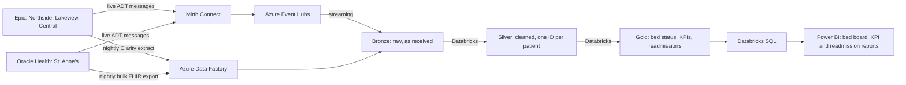

# Overview

## The problem

**In two sentences:** our network bought a fourth hospital that runs a different system from our other three. After that, we couldn't see free beds across all four in real time, and we couldn't tell when a patient left a hospital on one system and came back to a hospital on the other within 30 days, the kind of readmission Medicare penalises.

### The network

Four hospitals. Three have run Epic for years, all on one shared Epic system. The fourth, St. Anne's, was bought recently and still runs Oracle Health (the system formerly called Cerner). The network has grown by buying hospitals. Moving St. Anne's onto Epic is planned for about 18 months from now, and leadership didn't want to wait that long for one view of all four.

| Hospital | EHR (electronic health record system) |
|---|---|
| Northside | Epic |
| Lakeview | Epic |
| Central | Epic |
| St. Anne's | Oracle Health |

Each EHR is the hospital's main system: it holds every patient's record, every admission, every bed. Each one gives patients its own ID, called an MRN (medical record number). Across the shared Epic system a patient has one MRN; St. Anne's gives them a different one.

### Problem 1: nobody can see all the free beds

When the emergency department (ED) decides to admit a patient, that patient needs a bed upstairs. If there isn't one, they wait in the ED, sometimes for hours. That's called **boarding**, and it's one of the biggest pain points in hospitals today.

Often there *was* a free bed at another of our hospitals. The three Epic hospitals could see each other's beds in Epic, but St. Anne's beds existed only in Oracle Health. There was no single screen for all four, so finding a bed across the two systems meant the nursing supervisors calling each other.

### Problem 2: readmissions we couldn't see

Medicare is the US government's health insurance for people 65 and over, so it pays a large share of every hospital's bills. Its **Hospital Readmissions Reduction Program** compares how often a hospital's Medicare patients have an unplanned return within 30 days of discharge with how often you'd expect for patients like them. Hospitals with too many get a cut of up to 3% on all their Medicare inpatient payments for a year. The logic: many readmissions are avoidable (a patient sent home too early, confused about their medicines, or with no follow-up booked), and because Medicare pays per stay, a second stay used to earn the hospital more, not less. The cut makes avoidable readmissions cost money instead. It covers six conditions, heart failure among them, and a return to *any* hospital counts: Medicare links the stays through its own bills and the patient's Medicare ID, not through our EHRs.

*Example:* Margaret, 78, is treated for heart failure at Northside (Epic) and goes home. Twelve days later she's back, this time at St. Anne's (Oracle Health), under a different MRN and with her name entered differently. Inside the network nobody connects the two stays. Medicare does, from the two bills, and counts it against Northside, the hospital that discharged her. (Had she come back to Lakeview, Epic would have caught it: one system, one MRN.)

### Why not Epic's own tools, or just wait for Epic?

- **Epic's reporting databases are nightly.** Epic copies its live data into Clarity, and then Caboodle, its reporting warehouses, once a night. That's fine for reports, but a bed board needs to be live.
- **St. Anne's isn't on Epic.** Caboodle *can* load outside data, but we'd still have to build the Oracle Health feed and match patients across the two systems ourselves, and it still wouldn't be live.
- **The platform outlasts the move to Epic:**
  - Medicare's penalty looks back three years, so St. Anne's Oracle Health records keep counting long after it switches.
  - The next hospital the network buys plugs in the same way, whatever system it runs.
  - Every hospital, Epic or not, gets the same patient-flow KPIs (below).

## The solution

One data platform on Azure that takes in both EHRs on two paths: a **live path** for bed status, and a **nightly path** for full patient records. Both land in one lakehouse on Azure Databricks, which serves a live bed board, patient-flow KPIs and a readmissions report in Power BI.

**How to read it:**
- **Live path (top):** every time a patient is admitted, moved, or discharged, the EHR sends a short message called an **ADT** (admit, discharge, transfer) message, in the HL7 v2 format hospitals have used for decades. Mirth Connect, an interface engine, collects these from both EHRs and passes each one to Azure Event Hubs. Databricks reads them as a stream, so the bed board updates within minutes.
- **Nightly path (bottom):** once a night, Azure Data Factory copies the full records: an extract from Epic's Clarity database, and a bulk FHIR export from Oracle Health. FHIR (Fast Healthcare Interoperability Resources) is the newer, API-based health data standard, and "bulk export" means asking for many patients at once.
- **Bronze, Silver, Gold:** the lakehouse keeps data in three stages. Bronze is exactly what arrived. Silver is cleaned up, with each patient matched to one network-wide ID. Gold holds the business-ready tables the reports read.
- **Serving:** Databricks SQL answers the queries, and Power BI shows the bed board and the reports.

**What every hospital gets:** three KPIs, each with one definition used at all four hospitals. On their own, hospitals measure these differently (boarding, for example, can start at the admit decision or when the inpatient orders are done), so they couldn't be compared fairly.

| KPI | What it measures | Watches |
|---|---|---|
| ED boarding time | From the decision to admit until the patient leaves the ED for a bed | Patients waiting to get in |
| Discharge order to departure | From the doctor's discharge order until the patient actually leaves the bed | Patients waiting to get out |
| 30-day readmission rate | Share of patients back at any of our hospitals within 30 days, by hospital and condition | Patients coming back |

## Margaret's journey through the platform

**1. Admitted at Northside.** Epic sends an ADT admit message. Within minutes, the bed board shows her bed as taken:

| hospital | unit | bed | status | patient MRN |
|---|---|---|---|---|
| Northside | 4 West | 4W-12 | occupied | E1234567 |

**2. Discharged five days later.** Epic sends a discharge message, and the board marks her bed as no longer occupied.

**3. Back 12 days later, at St. Anne's.** Oracle Health sends an admit message, and the bed board shows her in a St. Anne's bed, under a *different* MRN.

**4. That night, Silver matches her two records** and gives both one network-wide ID:

| network_patient_id | source | mrn | first_name | last_name | date_of_birth | sex | address | phone |
|---|---|---|---|---|---|---|---|---|
| P-000417 | epic | E1234567 | Margaret | Lopez | 1947-03-02 | F | 14 Elm St | 555-0142 |
| P-000417 | oracle_health | S889201 | Peggy | Lopez | 1947-03-02 | F | 14 Elm Street | 555-0142 |

No single field proves it's her: plenty of people share a birthday, and "Peggy" is a nickname for Margaret, so exact matching would miss her. But last name, date of birth, sex, address and phone all agreeing almost never happens by chance. The matching tool, Splink, weighs every field into one match score, and rare agreements, like an unusual surname, count for more. Details in `03-lakehouse.md`.

**5. Next morning, the readmissions report shows the link:**

| network_patient_id | first_stay | discharged | came_back_to | readmitted | days_between | first_stay_reason | counts_for_medicare_program |
|---|---|---|---|---|---|---|---|
| P-000417 | Northside | 2026-03-06 | St. Anne's | 2026-03-18 | 12 | heart failure | yes |

The care management team sees it that morning, instead of finding out from Medicare's report long after.

## My role

I was the senior data engineer who designed this platform: I chose the tools, set up the lakehouse, and built the live bed-status pipeline and the patient matching. I worked with the nursing, bed management, and quality teams on what "a free bed", "boarding" and "a readmission" should mean, and I mentored a junior engineer on the team.
